<!--
  Profile README for @RameshwariS
  • Lines marked TODO are placeholders: fill them in or delete them.
  • Project links currently point to your profile. Swap in the real repo URLs
    (each project has two: the card image link and the "Repository →" link).
  • The banner, project cards and divider are generated by scripts/build-cards.mjs.
-->



<p align="center">
  <a href="mailto:rameshwaris1112@gmail.com"></a>
  <a href="https://github.com/RameshwariS"></a>
  <!-- TODO: add your LinkedIn, then uncomment
  <a href="https://www.linkedin.com/in/YOUR-HANDLE"></a>
  -->
  <!-- TODO: add your LeetCode handle, then uncomment
  <a href="https://leetcode.com/u/YOUR-HANDLE"></a>
  -->
</p>


## `01` About me

I like building the parts of software you don't see: gateways, rate limiters, booking backends and tools that keep ML experiments reproducible. Most of my work starts with "how would this hold up under real load?" and ends as something I can test and ship.

```go
type Rameshwari struct {
    Building  []string
    Learning  []string
    OpenTo    []string
}

var me = Rameshwari{
    Building: []string{"backend services", "API gateways", "ML tooling"},
    Learning: []string{"distributed systems", "system design"}, // TODO: edit
    OpenTo:   []string{"internships", "hackathon teams", "OSS collabs"}, // TODO: edit
}
```


## `02` Toolbox

**Languages**
<p>
  
</p>

**Backend & infra**
<p>
  
</p>

**Frontend**
<p>
  
</p>

**Databases & tools**
<p>
  
</p>


## `03` Featured projects

<table>
<tr>
<td width="50%" valign="top">

<a href="https://github.com/RameshwariS"></a>

### GoProxyX


An API gateway for microservices. Handles JWT auth, chained middleware, Redis-backed token-bucket rate limiting, dynamic reverse-proxy routing and central logging.

[Repository →](https://github.com/RameshwariS) <!-- TODO: real repo link -->

</td>
<td width="50%" valign="top">

<a href="https://github.com/RameshwariS"></a>

### DSV: Dataset Versioning System


A light, file-first toolkit for reproducible ML. Tracks datasets, params, preprocessing steps, metrics and artifacts without heavy infra.

[Repository →](https://github.com/RameshwariS) <!-- TODO: real repo link -->

</td>
</tr>
<tr>
<td width="50%" valign="top">

<a href="https://github.com/RameshwariS/OpenSourceCompanion"></a>

### OpenSourceCompanion


Helps beginners land their first open-source contribution. Search real GitHub issues by estimated difficulty, track them on a Kanban board, and see GitHub-verified PR stats, with a Redis cache in front of the GitHub API.

[Repository →](https://github.com/RameshwariS/OpenSourceCompanion)

</td>
<td width="50%" valign="top">

<a href="https://github.com/RameshwariS?tab=repositories"></a>

### More
Experiments, coursework and open-source contributions live on my profile.

[All repositories →](https://github.com/RameshwariS?tab=repositories)

</td>
</tr>
</table>


## `04` GitHub in numbers




<picture>
  <source media="(prefers-color-scheme: dark)" srcset="https://raw.githubusercontent.com/RameshwariS/RameshwariS/output/snake-dark.svg">
  <source media="(prefers-color-scheme: light)" srcset="https://raw.githubusercontent.com/RameshwariS/RameshwariS/output/snake-light.svg">
  
</picture>

<sub>Cards are rebuilt daily by a GitHub Actions workflow in this repo, from public data only.</sub>

<!-- TODO: put YOUR LeetCode username here, then uncomment
<p align="center">
  
</p>
-->


## `05` Badges

<p align="center">
  <a href="https://cloud.layer5.io/user/472bb70f-3e6f-49e1-a128-203f2be3e7e1?tab=badges&badge=first-design"></a>
  <br>
  <sup><a href="https://badges.layer5.io">Get your own badge</a></sup>
</p>


<p align="center"><i>Building systems, solving problems, and learning in public.</i></p>


